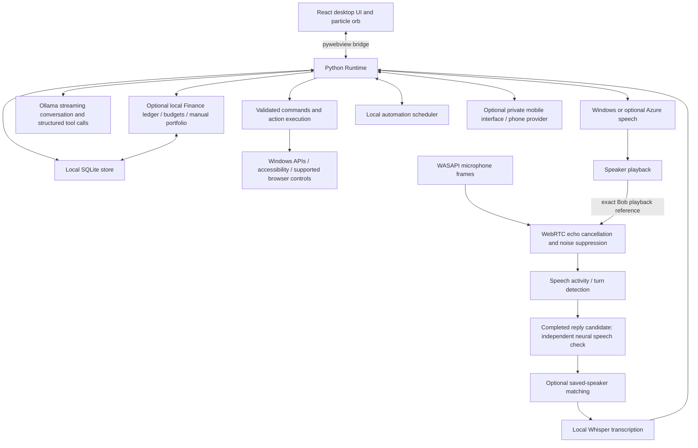

# Bob desktop architecture

This describes the Windows application, version 0.11.10. The older
`backend/` API and non-desktop frontend experiments are not the packaged
assistant's main execution path.

## Components

| Component | Source | Responsibility |
| --- | --- | --- |
| Native entry point | `desktop/main.py` | Starts pywebview and runtime; isolated diagnostics |
| Runtime bridge | `desktop/runtime.py` | UI API, jobs, tool execution, settings, cancellation |
| Desktop UI | `frontend/src/desktop/` | Chat, setup, settings, memory, planner, automations, appearance |
| Persistence | `desktop/storage.py` | Settings, conversations, profile memory, context, action history |
| Commands | `desktop/commands.py` | Supported schemas, planning, guarded execution |
| App discovery | `desktop/app_catalog.py`, `desktop/launch.py` | Installed-app discovery and launch verification |
| Voice | `desktop/voice.py` | Capture lifecycle, transcription, speaker checks, response ownership |
| Duplex audio | `desktop/duplex_audio.py` | Concurrent capture/playback, echo reference, interruption gates |
| Calibration | `desktop/microphone.py` | Device-specific levels and interruption floor |
| Speech output | `desktop/speech_output.py` | Speech chunks without silently truncating prose |
| Packaging | `desktop/Bob.spec`, `scripts/build-windows.ps1` | React build, models and native runtime |

## Conversation and action boundaries

Clear supported launches can use a fast local route. Complex requests use
Ollama interpretation and validated tool calls. The model does not gain arbitrary
shell access. Consequential or ambiguous actions retain approval checks.
An action result is distinct from generated conversational text; verification
coverage depends on the particular tool.

The microphone stays available during duplex playback. Interruptions require
a completed transcript, explicit trigger, saved-speaker match and confidence
checks. A one-use permit is bound to the current response before it can cancel
generation. Ordinary sound onset is not cancellation authority. Manual Stop is
separate. Speaker matching is approximate, not authentication.

The independent Silero gate runs on completed reply-interruption candidates,
not every ordinary idle command. A completed utterance can nominate a candidate
across consonant gaps, but nomination is not permission to stop. Explicit focus
verifies one selected profile; automatic identification still requires a clear
winner. Only accepted, confident matched-user requests update speaking-pause
statistics after activation checks. There is no automatic weight retraining.

Room listening mode is explicit: Balanced retains the original speech nomination
policy; Quiet room relaxes acoustic and neural speech thresholds for soft speech
and gaps. Mode changes require ending the voice session and response first. This
does not change saved-speaker or transcript-confidence thresholds, nor permit
sound-only cancellation. It is not automatic room classification or output pitch
control.

Small English is the default CPU INT8 recognizer. The optional bundled larger
Distil-Whisper Large v3 is selected through Settings; it uses more memory and was
slower in the recorded CPU comparison. Models do not download during normal use.
WASAPI startup uses explicit shared mode and retries a larger buffer on the same
endpoints. Isolated driver dropouts retain playback; repeated failures are errors.

## Data and integrations

Normal user data lives under `%LOCALAPPDATA%\Bob`, separate from the install
folder. Tests should use new isolated `--data-dir` directories. Personal memory,
voice profiles, recordings, pairing data, provider credentials and microphone
calibration are not sale/demo assets.

Finance is off by default. Its data uses dedicated local SQLite tables and never
enters the chat, memory or LLM prompt automatically. It has no bank or quote API.
The UI fetches on opening, refreshing or editing; there is no finance polling
worker. Hiding preserves records. Currency changes are blocked for a populated
ledger; money is stored in integer minor units. The feature is scoped to this
Windows workspace, not a biometric vault. See [Finance guide](FINANCE-GUIDE.md).

Ollama and its conversational model are installed separately. English Whisper
and the speaker model are bundled by the current build. Azure speech, Twilio
calls and remote phone access require additional setup; they are not included
service subscriptions. A mobile webpage does not provide an iPhone locked-screen
custom wake-word service. Daily automations require Bob and the PC to be running.

## Build and verification

`scripts/build-windows.ps1` installs dependencies, builds React, runs Python
tests, obtains speech models and packages the EXE with its `_internal` folder.
Downloads and installation require network access. The Whisper download is not
currently pinned to an immutable revision.

[Latest recorded validation](TEST-REPORT-0.11.10.md) separates simulated tests,
native diagnostics and live calibration. Those results are not certification of
all hardware, accents or third-party applications. See the
[customer release plan](CUSTOMER-RELEASE.md) for commercial scope and open requirements.
