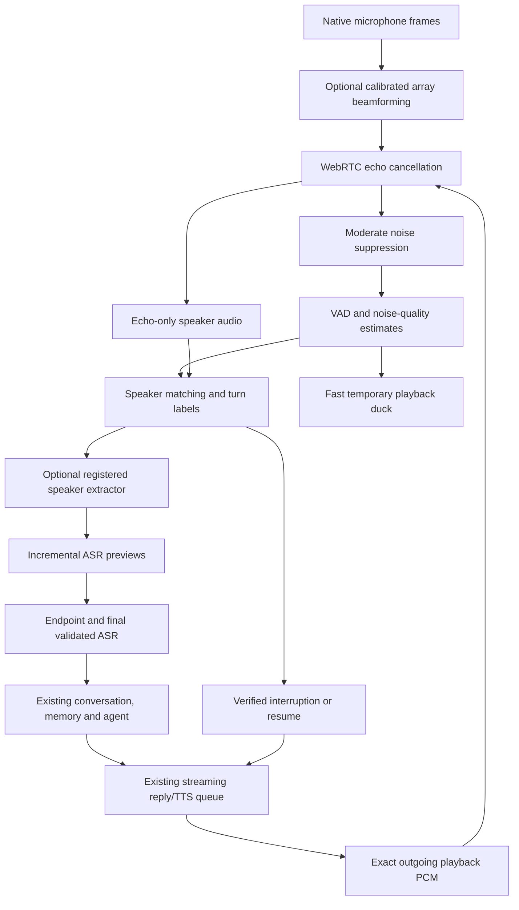

# Conversational audio: architecture and integration

## Inspection before implementation

The shipping Windows entry point is `desktop/main.py`: pywebview hosts the existing React/Vite desktop UI and exposes `Runtime` as the bridge. The separate FastAPI/browser frontend is not the EXE microphone path.

| Component | Existing implementation | Integration decision |
|---|---|---|
| Capture/playback | `desktop/duplex_audio.py`: sounddevice/WASAPI, 48 kHz, 10 ms frames, bounded callback queue | Keep the full-duplex stream and exact outgoing PCM reference |
| AEC/denoising | `pywebrtc_audio.AudioProcessor` (AEC3, moderate WebRTC suppression), separate echo-only speaker channel | Retain native DSP; add replaceable stages and optional calibrated array processing |
| Speech/endpointing | WebRTC VAD plus acoustic checks and `TurnDetector` with pre-roll/adaptive pause | Keep detector; add environment measurements and staged interruption behavior |
| Speaker matching | `desktop/speaker.py`: local ERes2Net, encrypted profiles, template consensus, optional primary-user focus | Reuse matching and memory IDs; preserve saved-voice restrictions |
| ASR | `desktop/voice.py`: local int8 faster-whisper small.en; final decode after endpoint | Add asynchronous bounded incremental previews; final validated decode remains authoritative |
| Conversation/actions | `Runtime`, `conversation.py`, cancellable local Ollama `ChatConnection`, existing Windows tools | Keep final-turn dispatch; never execute partial captions |
| TTS | `ReplyAudio` sentence queue, persistent Windows TTS/Piper/optional configured Azure | Keep providers and sentence streaming; gate exact playback frames for fast ducking |
| Profile memory | `Runtime.voice_conversation` and SQLite profile scopes | Reuse final recognized profile selection, not provisional recognition |

## Intended flow

A single microphone cannot reliably separate arbitrary overlapping voices. Known-speaker turn labels are not continuous multi-speaker diarization. Beamforming requires exposed synchronized channels and measured channel delays. Target extraction is an explicit replaceable interface; without a registered model it is reported unavailable, not simulated. Windows may already beamform a laptop's physical array into one exposed input channel.

Whisper previews are incremental window decoding with local agreement, not native token-streaming ASR. They run on a bounded worker, can be skipped when final recognition is busy, and never initiate actions. Caption changes can be revised until the final turn is accepted. Full-duplex capture/DSP continue independently.

Fast acoustic ducking and speaker-authenticated cancellation have different latency: a credible onset can reduce playback around 200–300 ms; voice matching requires more speech and model time. Timings must be measured, not advertised as guaranteed. Background noise or rejected speakers must not cancel a reply. User recordings, provisional text and temporary turn tracks remain in memory.
