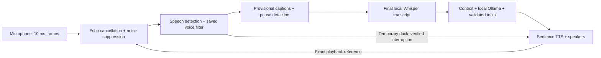

# Conversational audio: setup, commands, tests and limits

**0.11.1 quiet-room fix:** a possible noise onset no longer stops Bob's next sentence. Playback interruption and ducking require a separate sustained-speech check with unboosted, strict VAD and a minimum signal floor. Brief incidental captures while Bob speaks are discarded. Quiet capture while idle retains its sensitivity. See [the fix and five-step test](RELEASE-0.11.1.md).

## Start

1. Close the old Bob, then launch `Bob.exe` from the new Bob folder. Keep `_internal` beside it. Your usual profile data stays in its existing location.
2. Check Windows **Settings → System → Sound → Input** selects your laptop microphone. Keep the speaker volume moderate.
3. In Bob Settings, keep your existing matched voice. **Recognize my voice → Focused listening**: select yourself to ignore other saved speakers, or all saved voices to let enrolled people take turns. Voice identification is approximate personalization, not authentication.
4. **Conversational audio**: Moderate suppression, live captions, playback lowering and learned pauses are recommended starting settings. Click **Save settings**, end any active voice conversation, then start a new one to apply DSP/caption changes.
5. Start voice conversation or say “Hey Bob,” wait for the cue, and speak. The microphone stays active while Bob talks. Use a full natural sentence if very short speech does not match your saved voice.

## What the audio loop does

The speaker identity path has echo cancellation without extra suppression to preserve voice characteristics. The transcription path uses suppression. Live captions are revised window decodes, not final commands. Captions appear only after the local model is loaded and can be skipped when it is busy. They use additional CPU; turn them off for lighter operation.

## Try the new behavior

| What to test | Say / do | Expected result |
|---|---|---|
| Normal voice | “Bob, explain why the sky is blue.” | Final words enter chat; concise spoken explanation. |
| Provisional caption | Say a sentence lasting 5–8 seconds | “Hearing…” appears provisionally while capturing; only the completed turn is submitted. |
| Natural interruption | While Bob explains, say “Actually, just give me the short version.” | Playback lowers while identity is checked, then the matched turn redirects the reply. New words remain available. |
| Correct an action | Ask for a reminder with confirmation, then “No, I meant Friday.” | The pending unexecuted reminder changes date and requests fresh approval. It does not duplicate the reminder. |
| Numbered choice | Ask Bob to give two numbered options, then “The second one.” | The observed second option is supplied as context. If no option exists, it must not invent one. |
| Topic continuity | “Continue” after interrupting an explanation | Interrupted answer is available in this conversation’s context; actions still require a new validated intent. |
| Existing repeat | “Set volume to 25 percent,” then “Do that again.” | Uses the existing action context. Verify Windows volume; native failures must be reported. |
| Thinking pause | “Open the file and…” pause briefly, then finish | A fresh incomplete caption can extend the quiet pause, up to 1.8 s. This cannot perfectly infer thought. |
| Give me room | “Give me more time to think.” | Sets the existing 1.8-second pause preference. |
| Quick mode | “Switch to fast mode.” | Brief spoken response; full text remains visible. |
| Tutor | “Switch to tutor mode,” then “Explain how a CPU works.” | More detailed explanation with a slower pace. |
| Focus | “Switch to focus mode.” | Task-focused phrasing. |
| Driving | “Switch to driving mode.” | Brief, unhurried speech. No vehicle, navigation or driving sensors are added. |
| Meeting / silent | “Switch to meeting mode” or “Text only.” | Reply appears as text; automatic speech stops. Explicit Read aloud remains available. |
| Speak again | “Speak again.” | Restores balanced mode. |
| Public | “Switch to public mode,” then ask about a saved fact | Spoken output only says details are on screen. Full visual text may still be private: protect your screen. |
| Bedtime | “Switch to bedtime mode.” | Calm, brief wording and slower speech. |
| Privacy / profile | Select a different enrolled person; ask about their saved preferences | Conversation/profile routing stays separate; uncertain identity cannot borrow another user’s memory. |
| Background noise | Use normal laptop fan/room noise, then repeat a full sentence | Observe capture, final words and match result. Impulses should not cancel the reply; noisy rooms can still reduce accuracy. |
| Primary user | Focus your saved profile; let another person speak, one at a time | Other identities must not dispatch a command. Overlapping speech may be rejected rather than separated. |
| Failure honesty | Stop Ollama, then request an action requiring interpretation | Shows model failure; no guessed action or automatic replay. Start Ollama and issue a new request. |

Avoid a destructive task as an audio test. Test navigation, calculator or reversible volume changes first. Closing all YouTube tabs still uses the existing observed-tab context/verification; this release does not replace Edge automation.

## Settings and diagnostics

- **Lower Bob’s voice when speech starts:** fast acoustic duck, followed by verified cancellation when saved-voice filtering is enabled. Rejected speech restores playback. A brief noise-induced dip is possible. Disable if it distracts you.
- **Live provisional captions:** a latest-only worker holds at most one pending preview; old-turn results are dropped. Model inference already running cannot be forcibly preempted. Final transcription can wait for that bounded window decode to finish.
- **Noise suppression:** Light/Moderate/Stronger are native WebRTC levels. Restart voice mode after saving. Stronger suppression can lose quiet consonants; try Moderate first.
- **Learn my speaking pauses:** local count and average pause length only, scoped by matched profile. Saved when voice conversation ends. **Forget learned speaking pauses**, then Save settings, removes saved statistics. Explicit Quick/Patient/Thinking pauses take priority.
- **Group attention filter:** conservative activated-session heuristic. It can reject speech that appears addressed to another person. It does not inspect a camera or identify the direction of a single microphone. Keep voice matching enabled and focus your profile for primary-user preference.
- **Autonomy 0/1:** answer/inspect or propose changes; **2:** confirm changes; **3:** existing low-risk automatic execution with native sensitive confirmations; **4:** same sensitive checks, suitable for user-authored trusted routines. Level 4 does not grant arbitrary shell access or bypass permissions. The compatibility default is 3; it preserves prior user-approved behavior.
- **Diagnostics:** measured environment/SNR, attention state, playback ducks, inference and request timing aggregates. SNR is a rough estimate requiring quiet observations, not a calibrated microphone measurement. “TTS dispatch” means speech was handed to synthesis, not that physical sound had already started. Reset clears RAM metrics. There are no claimed false-activation accuracy percentages without labeled trials.

## Data boundaries

Acoustic frames and provisional captions remain in bounded memory. Final messages continue to use Bob’s existing conversation history. Existing encrypted voice profiles and profile-scoped personal memory are reused. Newly learned pause statistics contain no recording or transcript. Structured dialogue context and action ledger are process-local, scoped by conversation, and bounded. Mode and audio preferences persist locally. Diagnostic counters are session-local. Turning memory off retains the existing memory controls; delete saved facts through Memory.

No new camera, contact, calendar, mail, phone or cloud access is started by this upgrade. Future extractors or multi-device sources must be explicitly installed/registered. An API/interface is not evidence of an available model or hardware feature.

## Requirement coverage

| Requested area | Delivered scope / remaining boundary |
|---|---|
| Attention, states, social awareness | Activated-session states, separate speaker evidence, optional group heuristic. No gaze/direction inference. |
| Domain prediction, safe anticipation | Provisional local domain and completion hints only. No speculative tool calls or external reads. |
| Micro-turns, corrections, references | Observed numbered options, previous goal/interrupted answer, existing frozen pending actions and native target context. Arbitrary ambiguous pronouns still need clarification. |
| Semantic endpointing / pause model | Partial-text incompleteness and observed pause statistics. No trained prosody/end-of-turn neural model. |
| Interruption understanding | Temporary duck, bounded identity checks, preserved new audio and interrupted answer; reply edits cannot replay tools. |
| Response planner / modes / verbosity | Structured speech policy, sentence budget, text-only/public output, pace adjustment, existing personality preferences. |
| Confidence / recovery | ASR confidence, separate identity scores, attention heuristic, validated tool arguments, explicit failure/confirmation metadata. Not one combined accuracy score. |
| Vocabulary / memory / compact context | Existing editable pronunciation hints and profile memory; bounded per-conversation observed context. No unsolicited mining of private contacts or automatic guest prints. |
| Acknowledgements / backchannels | Existing concrete step progress and sentence streaming. No artificial “mm-hm” loop or simulated human thinking. |
| Environment / device selection | Native suppression, signal heuristics, calibrated array implementation; source-selection policy seam with consent/hysteresis. Automatic live microphone switching and multi-device fusion are not enabled. |
| Diarization / extraction | Existing enrolled-speaker matching per completed turn and primary focus. No continuous unknown-speaker diarization or installed overlapping-voice separator. |
| Action lifecycle / autonomy / cancellation | Process-local IDs/states, frozen approvals, no automatic failed-action replay; existing native validation/cancellation retained. Process restarts do not provide exactly-once delivery guarantees. |
| Metrics / optimization | Bounded observed timings/counters and reset controls. No unsupervised accuracy learning or guaranteed latency. |
| Camera / privacy | Camera remains off/unimplemented; public/meeting/silent voice policy available. |

## Repeatable verification

The folder includes a test report. `Bob.exe --conversation-audio-test --data-dir <new-empty-folder>` runs native simulated echo/DSP and controlled endpoint checks without a microphone or commands. It writes `conversation-audio-test.json` into that isolated folder. Do not use your real Bob data directory for diagnostics.

For your own acceptance test, perform the table above with your usual microphone and record which final words/actions were correct. Test normal conversation first, then fan noise, then a nearby speaker taking turns. Overlap and short one-word identity checks are the hardest cases. Use **Test voice match** before re-recording: your prior full-sentence check matched both audio paths; do not create duplicate profiles merely because a command was missed.
