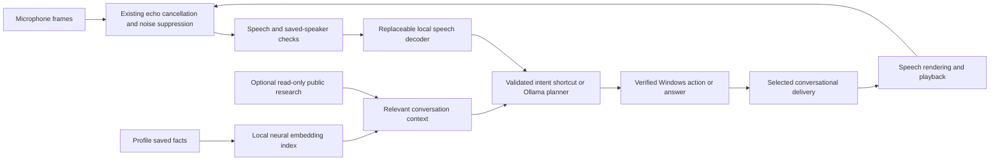

# Bob 0.11.15 — neural memory and expressive conversation

## What changed

- Replaced the final speech decoder internals with a separate recognition module. Captured audio is decoded once, normalized conservatively, checked for clipping and reused for an evidence-gated recovery pass. Cancellation, speaker checks, AEC and the existing application structure remain in place.
- Added optional neural retrieval over saved facts using local Ollama `nomic-embed-text`. Relevant facts can be found even when a question uses different words. Indexes and learned shortcuts are scoped to the recognized profile, with a separate general workspace.
- Added small local shortcuts for verified common voice requests. They save a validated intent, execute it again and verify the new result. They never replay old success messages. Ambiguous, context-dependent and sensitive actions continue through the normal planner.
- Added optional public HTTPS research for explicit web questions and selected current-information questions, with source links. Failed lookup is reported rather than presented as a verified answer. Web content is treated as evidence and cannot authorize PC actions.
- Added Auto, Warm, Calm, Bright, Serious and Neutral voice delivery. Windows speech uses bounded SSML pitch/pacing, with plain-speech fallback; configured Azure speech also receives prosody. Short Windows renders have a bounded RAM cache.
- Added switches, expression selection, shortcut inspection/deletion and neural-index clearing in Settings. The embedding model is excluded from the chat-model picker.

## Simple setup

1. Quit older Bob and run `dist/release-0.11.15/Bob/Bob.exe`. Keep `_internal` beside it.
2. Keep Ollama running with your existing chat model. For neural memory, install `ollama pull nomic-embed-text` once. This model is already installed on this development PC, but is not bundled in the EXE.
3. Open Settings → Conversational audio → Conversation, learning and internet. Enable the features you want, choose Auto or a fixed voice expression, and Save settings.
4. Select an installed Windows voice under Voice & personality, or your separately configured Azure voice. Click Listen to this voice. Azure remains optional and may incur provider charges; local Ollama and Windows speech do not require it.
5. For voice-specific memory, enable saved-voice identification and select your profile. Otherwise use the general workspace. New installations keep internet, shortcuts and neural retrieval off until enabled.

## Read these to test

Prefix spoken requests with “Hey Bob” under the default wake policy.

| Feature | Example and expected result |
| --- | --- |
| Saved memory | “Remember that my dietary preference is vegan.” Check Memory, then “What should I consider when choosing dinner?” The saved fact can inform the reply. Neural indexing happens in the background; first retrieval may use lexical memory. |
| Profile separation | Switch to a different enrolled profile and ask about the first person's diet. Their profile facts must not appear as your own. Approximate voice identification is not a security boundary. |
| Clear index | Expand Learned commands and click Clear neural memory index. The facts remain visible in Memory; indexing can resume while enabled. Delete facts in Memory to remove them permanently. |
| Intent shortcuts | Say “Set the volume to forty percent,” check the actual volume, then “Please set volume to 40.” Both execute and verify the current volume. Eligible successful single actions can appear under Learned commands. |
| Context safety | After a window discussion, say “Close all those.” This uses the existing conversation planner; it is never learned as a generic shortcut that closes unrelated windows. |
| Web research | “Search online and tell me what Python is.” Expect relevant source links. Search snippets may be stale or incomplete. |
| Read a page | “Summarize https://www.python.org.” Expect a bounded public-page summary with its source URL. Authenticated/private pages and binary documents are unsupported here. |
| Offline web failure | Turn Internet research off, then repeat the online request. Expect a setup message, with no invented online verification. |
| Calm voice | Choose Calm, Save, then Listen to this voice. Compare with Bright and Neutral using the same voice. Provider voices differ in how natural this sounds. |
| Auto delivery | Choose Auto, then “I feel stressed. Help me take one small step.” Delivery is calmer; “Tell me a funny short story” selects brighter delivery. The cues come from words, not mind reading. |
| Interruptions | During a spoken reply, say “Hey Bob, please stop talking” in your saved voice. Table taps alone must not cancel it. This still needs a real microphone/speaker test on your PC. |
| Decoder recovery | Speak normally after the wake phrase. If captured audio yields no words, expect an explicit repeat request, not a silent successful command. |

## How it works

Neural embeddings help retrieve memories; the existing chat model forms sentences. This update does not continuously retrain model weights, scrape training data, infer feelings from vocal biometrics or make Bob conscious. It expresses a supportive conversational style. Existing personality controls still shape wording. No raw microphone recordings are saved for learning.

## Limits and privacy

Public research sends the current search question to a public search engine. It does not add saved memories or microphone recordings. Do not put secrets into a public search question. Direct reading supports bounded public HTTPS text only; no login, forms or local-network access. Sources can be incomplete and must be assessed rather than blindly trusted.

Neural memory requires loopback Ollama and falls back to existing lexical retrieval if unavailable or outside its query-time budget. At most 100 facts are considered for neural ranking per query; indexing is bounded to eight missing facts per batch. Learned shortcuts are bounded to 100 per profile. Clear controls remove local derived data without deleting saved facts.

Speech remains buffered/local Whisper with existing incremental captions, not a new native token-streaming ASR model. No overlapping-speaker separation or universal accent/noise guarantee is added. Real microphone interruption quality and subjective voice naturalness require user acceptance; generated-speech tests do not prove them. No live microphone recording or phone call was made for this release.

See the complete user manual and natural command catalog for all existing features. Verification results are in Test-Report.md beside the release.
