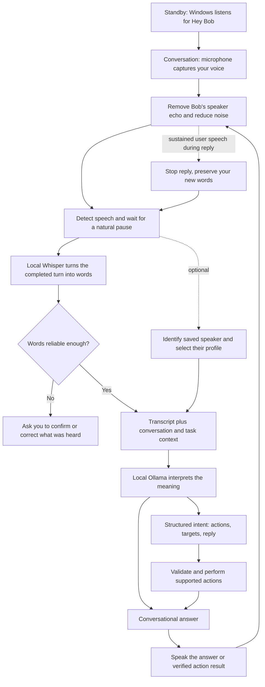

# How Bob hears and answers you

Bob has three separate jobs: detect when you speak, turn sound into words, and decide what those words mean. Recognizing your identity is a fourth, optional job. Saving a voice profile does not train Whisper to spell every word you say correctly.

## 1. Waking up

In standby, a small Windows speech recognizer listens for the configured wake phrases, including “Hey Bob.” It is separate from Whisper, so Bob does not need to run the full transcription model continuously. In a voice conversation, you can speak without pressing the microphone for every turn. Wake listening pauses during that conversation.

## 2. Hearing you through the speakers

The conversation loop captures the default Windows microphone and plays through the default output device. WebRTC echo cancellation receives a copy of Bob's exact playback audio, helping it subtract that sound from the microphone. Noise reduction and speech detection then help reject hiss, clicks and brief noises. Sound is processed in small 10-millisecond blocks with a short buffer that preserves the start of your sentence.

Echo cancellation is not perfect: loud speakers, room echoes, microphone placement and another person speaking can still cause mistakes. Optional speaker recognition does not currently make the interruption detector owner-only. If duplex audio cannot start, Bob reports that limitation and uses turn-by-turn recording instead.

## 3. Knowing when you have finished

Bob measures speech and pauses; it cannot literally know that you are still thinking. In Settings, Natural pacing now adapts to the amount of detected speech in the turn:

| Speech in the turn | Quiet pause before transcription |
|---|---|
| Under 0.6 seconds, often a short “yes” | 0.45 seconds |
| Ordinary requests | 0.65 seconds |
| At least 2.5 seconds of speech | 0.95 seconds |

Speaking again before that pause ends continues the same recording. Quick, Patient and Thinking retain their explicit fixed pauses; voice enrollment retains its longer pause. Recordings are bounded to about 20 seconds. These are timing heuristics, not grammatical sentence detection. Choose Patient or Thinking if Bob still cuts off your pauses.

## 4. Turning sound into words

Bob uses the bundled English Whisper model locally, with faster-whisper, compressed int8 computation and two CPU threads. It transcribes a completed speaking turn, rather than showing each word as you speak. Vocabulary hints help with names and custom terms. Confidence and no-speech checks flag uncertain transcripts for review instead of silently treating them as reliable commands. Confidence is a useful estimate, not a guarantee.

This version prepares the model in the background when a conversation starts. It reuses it between turns and releases it after approximately three minutes without transcription during a session, or one minute after leaving the session. It can reload later. This removes repeated loading work; total response time still includes transcription, command execution, model generation and voice rendering.

## 5. Recognizing who spoke

Optional local speaker identification compares acoustic features with enrolled profiles. A confident match can select that person's profile, memory and greeting. An uncertain match preserves the current conversation and does not itself block ordinary commands. Short words, changed microphones and background noise make identification harder. It is personalization, not secure authentication. Profiles can be disabled or removed in Settings.

## 6. Understanding and doing the request

Spoken tasks now go to local Ollama first. Recent conversation, selected targets and executed actions help it understand paraphrases and corrections. A bounded structured JSON intent plan selects supported actions and literal parameters, which still go through validation, confirmation and verified execution. Wake/stop/approval controls, explicit conversation preferences and saved routine playback remain immediate; ordinary text retains its fast command path. Completed plans marked with a final step skip the extra model round after successful execution. References such as “those” depend on the preceding selection and supported context. Bob does not have unlimited control of every app, and grammar repair must preserve literal dictation rather than rewrite what you asked it to type.

Actions should report observed results where verification exists. A website opening, tab closure or system change can fail and must not be treated as successful just because a model says so. Important or destructive actions can still require approval.

## 7. Answering and interruptions

Bob speaks through the selected Windows voice or configured Azure neural voice. Informational answers can be spoken in sentence chunks as generation progresses; actions report their results after execution. Sustained detected speech can stop an active answer while preserving your replacement request. Brief noise should be rejected by the onset filters. Native actions already executing are protected from acoustic cancellation so their results are not lost; interrupting speech is not an instant rollback of an action.

## Try the new pacing

1. Quit the old Bob from its tray menu. Launch the current Bob.exe and keep its `_internal` folder beside it.
2. In Settings choose **Natural · adaptive pacing**. Use the correct Windows default microphone and speaker.
3. Say “Hey Bob,” then “What time is it?” Bob should answer aloud.
4. Try a short approval, “Yes,” when Bob asks for one. It should finish listening sooner than an ordinary request.
5. Say “Explain how rain forms,” then interrupt with “Actually, open calculator.” Check both the response and the actual Calculator window.
6. Try a longer request with a brief breathing pause. If your normal pauses exceed the timing above, choose Patient or Thinking.

The desktop pipeline is currently English and completed-turn transcription. These changes do not add multilingual streaming recognition, locked-iPhone wake listening or a guarantee of perfect identity accuracy. Normal transcription does not save recordings to disk; saved speaker profiles and configured cloud voice/call services have their own data handling.
